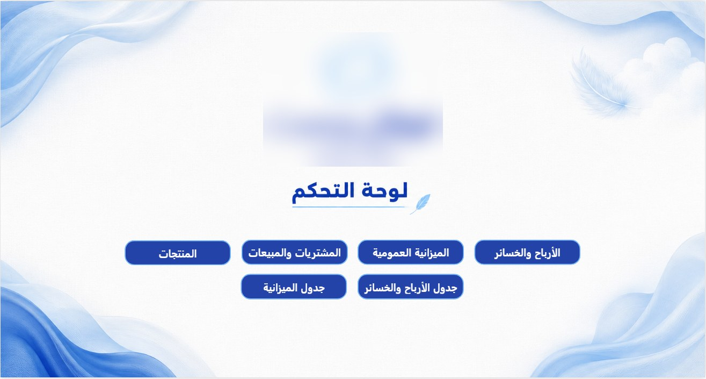
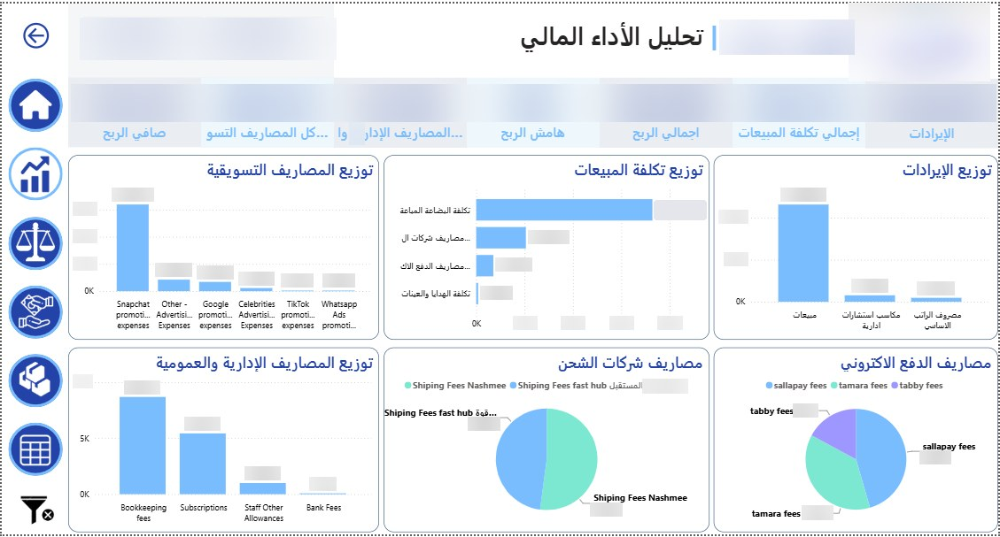
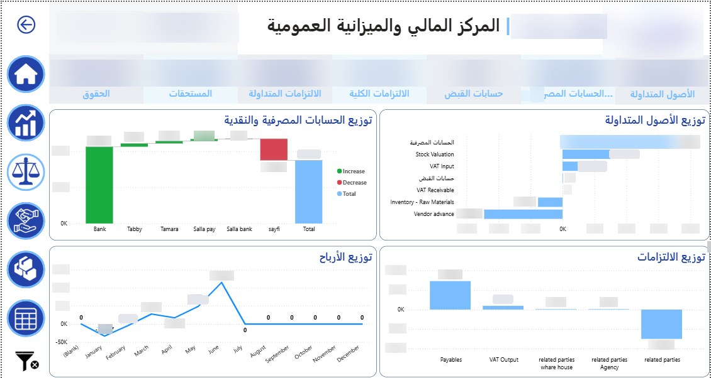
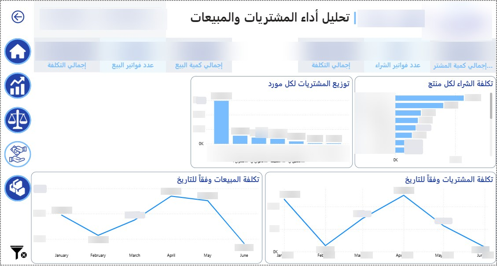
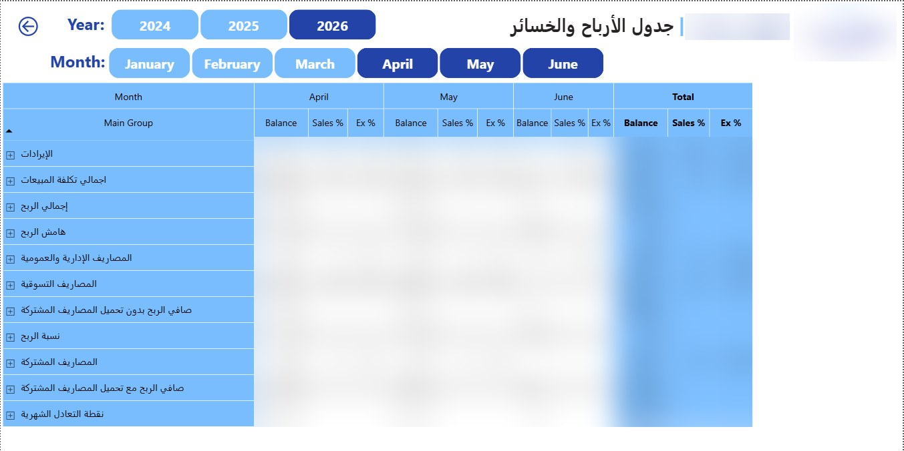

# Multi-Company Analytics Platform: Odoo 19 → PostgreSQL → Power BI


A freelance project delivered for a group of **11 companies** running on **Odoo 19**. It turns each company's financial and operational data into automatically refreshed Power BI reports, served from one central web portal with per-user access.

> This repository is a **showcase**. Code and data belong to the client and are not published. Screenshots are from one of the 11 companies, with the company name and all figures blurred, and are shared with the client's permission.

---

## 📌 What Was Built

- **11 tailored dashboards:** each company has its own PostgreSQL database and a Power BI report designed around its business, not a single shared template.
- **Consolidated group dashboard:** one data model combining **8 subsidiaries** of the parent company, so performance can be viewed per company or for the whole group.
- **Financial & operational coverage:** profit & loss, balance sheet and financial position, sales and purchases, products, and KPI tables.
- **Data modeling:** data models with KPIs and DAX measures (profit margin, break-even, expense ratios, ...), and Power Query transformations on top of Odoo's accounting tables.
- **Automatic refresh:** scheduled refresh **8 times a day** for every dashboard on Power BI Service.
- **Central analytics portal (PHP):** login, an admin panel to manage users and reports, and per-user access so each user sees only the dashboards assigned to them.
- **Deployment:** the portal runs on an **Ubuntu VPS** behind **Nginx**.

## 🏗️ Architecture

```
 Odoo 19 (×11 companies)
        │
        ▼
 PostgreSQL (one database per company)
        │
        ▼
 Power BI data models (Power Query + DAX)
        │   scheduled refresh ×8/day
        ▼
 Power BI Service ──► PHP Analytics Portal (login · admin panel · per-user reports)
                      Ubuntu VPS + Nginx
```

## 📊 Dashboard Pages

| Page | Highlights |
|---|---|
| **Financial Performance (P&L)** | Revenue, cost of sales, gross and net profit, margin, marketing / admin / shipping / e-payment expense breakdowns |
| **Financial Position & Balance Sheet** | Current assets, bank and cash accounts (waterfall), liabilities, equity, monthly profit trend |
| **Purchases & Sales** | Purchase cost per supplier and per product, sales and purchase cost over time |
| **Products** | Product-level performance |
| **P&L and Balance Sheet Tables** | Monthly matrix with sales % and expense % per line, profit ratio, and monthly break-even point |

## 🖼️ Screenshots

**Home**


**Financial Performance**


**Financial Position & Balance Sheet**


**Purchases & Sales**


**Monthly P&L Table**


## 🛠️ Tech Stack

Odoo 19 · PostgreSQL · Power BI Desktop & Service · Power Query · DAX · PHP · HTML · CSS · JavaScript · Nginx · Ubuntu VPS

---

Built by [Kareem Adel](https://www.linkedin.com/in/kareem-adel-mostafa/), freelance Data Scientist & BI Developer. Available for similar projects on [Mostaql](https://mostaql.com/u/Kareem_Adel_0).
